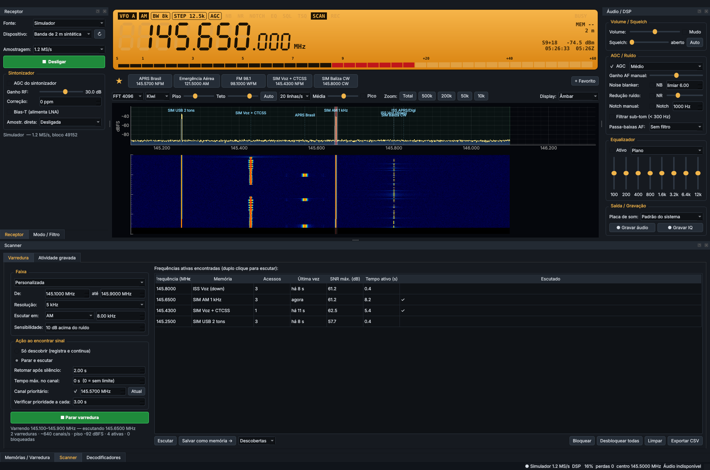
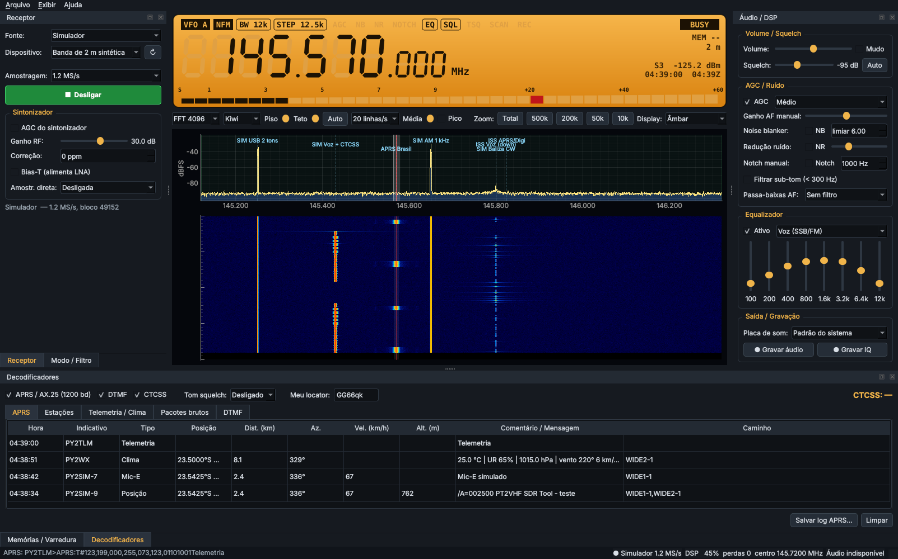
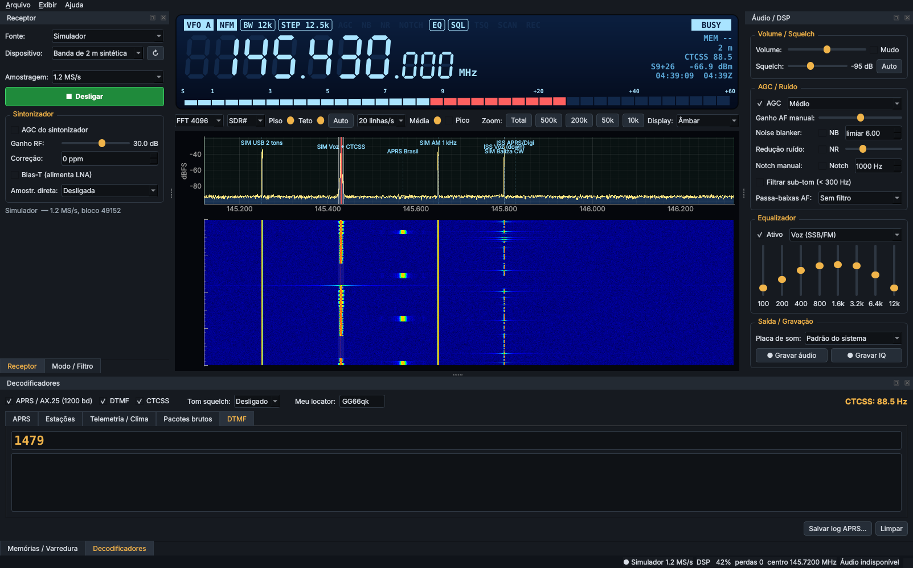
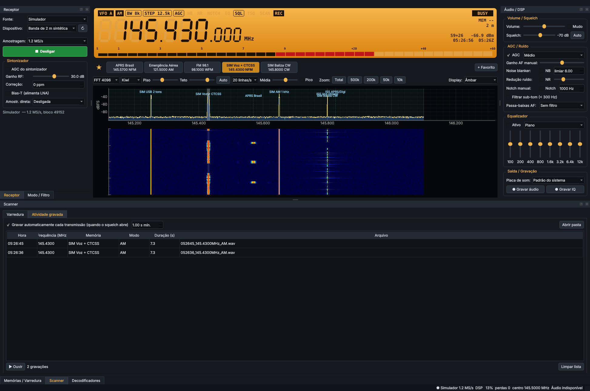

# PT2VHF SDR Tool

Receptor SDR para radioamadores com **interface de painel de rádio** (display LCD de 7 segmentos,
S-meter, VFO A/B, memórias) e **waterfall** no estilo KiwiSDR / SDR# / SDR++.
Funciona com **RTL-SDR**, servidores **rtl_tcp**, qualquer rádio suportado pelo **SoapySDR**
(Airspy, HackRF, SDRplay, LimeSDR…), **gravações IQ em WAV** e um **simulador** de banda embutido
(para testar sem hardware).

Plataforma inicial: **Windows** (também roda em Linux/macOS).





## Recursos

### Display de rádio (LCD)
- Frequência em dígitos de 7 segmentos com "segmentos fantasma", temas **Âmbar, Verde, Azul (negativo), Noturno, Branco**.
- **Roda do mouse sobre um dígito** altera aquele dígito; clique na metade de cima/baixo = +1/−1.
- **Entrada direta**: digite `145.57` + Enter (MHz) — ou `7100` + Enter (kHz).
- S-meter segmentado (S1…S9+60) com retenção de pico, leitura em dBm, indicadores
  AGC/NB/NR/NOTCH/EQ/SQL/TSQ/SCAN/REC/BUSY, canal de memória, banda, CTCSS detectado e relógio local/UTC.

### Waterfall / espectro
- Clique para sintonizar (com arredondamento ao passo), **arraste o passband** para sintonizar,
  **arraste as bordas** para mudar a largura (passband assimétrico, como no KiwiSDR).
- Zoom com a roda do mouse, botões de zoom rápido (Total/500k/200k/50k/10k), duplo clique = zoom total,
  **Ctrl+roda** = sintonia por passos.
- FFT de 1024 a 32768 pontos, velocidade (5–50 linhas/s), média do espectro, retenção de pico.
- Piso/teto ajustáveis e **Auto** (como o "auto-scale" do KiwiSDR).
- Paletas: Kiwi, SDR#, Fósforo, Âmbar, Cinza, Inferno.
- Histórico do waterfall **desloca junto** quando a frequência central muda.
- Marcadores das memórias e faixas do plano de bandas sobre o espectro.

### Demodulação e áudio
- Modos **NFM, WFM, AM, USB, LSB, CW, DSB, RAW** com larguras pré-definidas e ajuste fino.
- De-ênfase WFM 75 µs (Américas) ou 50 µs; de-ênfase opcional em NFM; tom de CW ajustável.
- **Squelch** por nível com histerese, botão **Auto** (6 dB acima do ruído) e **tom squelch (CTCSS)**.
- **AGC** rápido/médio/lento com *hang*, ou ganho manual.
- **Noise blanker** (IQ), **redução de ruído** espectral (NR), **notch** manual,
  filtro de sub-tom (<300 Hz) e passa-baixas de áudio.
- **Equalizador gráfico de 8 bandas** (100 Hz–12 kHz) com presets (Voz, Voz clara, Telefonia, Música…).
- Volume, mudo, limitador suave, escolha da placa de som.
- **Gravação** de áudio (WAV 48 kHz) e de **IQ** (WAV estéreo, compatível com SDR#/SDR++).

### Memórias prontas e favoritos
- **Pacotes de memórias prontas** (botão *Memórias prontas…*): radioamador (chamada e fonia),
  FT8/FT4/WSPR, satélites/ISS, aviação, marítimo VHF (simplex, DSC, AIS), PX 11 m (40 canais),
  FRS/PMR446 e sinais horários (WWV/CHU).
- **Barra de favoritos ★** acima do waterfall: teclas de memória de um clique, como num rádio.

### Scanner por espectro
- Varre faixas inteiras **pelo FFT**, segmento a segmento — salta direto para onde há sinal
  (centenas de canais por segundo com um RTL-SDR).
- Faixas prontas (aviação, marítimo, 2 m, 70 cm, VHF/UHF serviços, FRS, PMR446, PX, radiossondas,
  FM, ondas curtas) ou faixa personalizada; resolução e sensibilidade (dB acima do ruído) ajustáveis.
- **Só descobrir** (monta a lista de frequências ativas com acessos, horário, SNR e tempo ativo)
  ou **Parar e escutar** (retoma após o silêncio), **canal prioritário**, **bloqueio** de frequências.
- Salve as descobertas como memórias com um clique; exporte a lista em CSV.
- **Gravação automática por atividade**: cada transmissão vira um WAV, para ouvir depois.



### Memórias e varredura
- Memórias com **categorias** (Repetidoras, Simplex, APRS/Digital, Satélites, Aviação, Marítimo, Broadcast…),
  banda detectada automaticamente, modo, largura, CTCSS, deslocamento de repetidora, notas, favoritos.
- **Importa/exporta CSV do CHIRP** (leve as memórias do seu HT para o SDR e vice-versa).
- **Varredura de memórias** por categoria, com tempo de permanência e retomada automática.
- Plano de bandas (IARU R2 / Brasil): HF, PX (11 m), 6 m, FM broadcast, aviação, 2 m, marítimo, 70 cm…
- VFO A/B, A⇄B, A=B.

### Novidades da 0.4
- **Modo AUTO**, **auto-sintonizar ao selecionar** (tecla A-SINT), **◀ ▶ transmissão vizinha** e **modos clicáveis
  no display**.
- **Níveis de interface** Essencial / Intermediário / Avançado (menu Exibir ou barra do waterfall).
- **Gravação VOX** (pré-gravação de 0,5 s; arquivo único ou por transmissão; também IQ).
- **Aba Configurações** e **interface web** local/LAN: display, waterfall, APRS e áudio no navegador.
- **RTL-SDR robusto**: reconexão automática, aviso de faixa sem suporte, driver RTL-SDR Blog (V4) e
  **Preparar RTL-SDR** (driver WinUSB, como o Zadig).

### Assistente de sintonia, voltar no tempo e receptores extras
- **Auto-sintonia SSB**: corrige o VFO pela estrutura harmônica da voz (sem mexer no áudio); modo contínuo opcional.
- **Detectar modo**: WFM, NFM, AM, CW ou USB/LSB, ajustando modo, filtro e sintonia.
- **Ajustar filtro**: passband ajustado à largura real do sinal.
- **Voltar no tempo**: reouça os últimos 10–60 s de qualquer frequência da faixa.
- **Receptores extras**: até 4 canais da mesma faixa ao mesmo tempo.
- **Transcrição local opcional** das transmissões gravadas (`pip install faster-whisper`).

### Decodificadores
- **APRS / AX.25 1200 bd (AFSK Bell 202)** com vários fatiadores (compensa pré-ênfase, estilo Dire Wolf):
  posição normal e compactada, **Mic-E**, objetos, status, mensagens, **telemetria** (`T#`) e **estações meteorológicas**.
  Distância e azimute a partir do seu locator Maidenhead; tabela de estações; exporta log CSV.
- **DTMF** (Goertzel) e **CTCSS** (51 tons padrão).

### Fontes de sinal
| Fonte | Observações |
|---|---|
| RTL-SDR (USB) | ganho/AGC do sintonizador, correção ppm, **Bias-T**, **amostragem direta** (HF no RTL-SDR Blog V3/V4) |
| rtl_tcp | RTL-SDR remoto em rede (`rtl_tcp -a 0.0.0.0`) |
| SoapySDR | Airspy, HackRF, SDRplay, LimeSDR… (requer SoapySDR instalado) |
| Arquivo IQ | WAV estéreo I/Q; frequência lida do nome do arquivo (`…_145570000Hz_…`) |
| Simulador | banda de 2 m sintética com APRS, voz+CTCSS+DTMF, CW, AM, USB e uma FM em 98,1 MHz |

Taxas de amostragem: 0,24 / 0,96 / 1,2 / 1,44 / 1,92 / 2,4 / 2,88 MS/s (múltiplos de 240 kHz,
para decimação exata até 48 kHz).

## Instalação (Windows)

### Executável
Baixe o **instalador** ou a **versão portátil** em **https://www.pt2vhf.com/sdr** (downloads e
atualizações oficiais somente pelo site). O programa avisa quando há versão nova e se atualiza sozinho,
conferindo tamanho e SHA-256 do pacote.

### A partir do código
1. Instale o Python 3.10+ (64 bits).
2. No diretório do projeto:
   ```bat
   pip install -r requirements.txt
   python run_pt2vhf.py
   ```
3. Para gerar instalador e portátil localmente: `build_windows.bat` (requer Inno Setup 6).

### Driver do RTL-SDR
No Windows o dongle precisa do driver **WinUSB**: use o **Zadig** (Options → List All Devices →
"Bulk-In, Interface (Interface 0)" → WinUSB → Replace Driver). A biblioteca `librtlsdr` já vem com o
pacote `pyrtlsdr[lib]`.

## Atalhos
| Tecla | Ação |
|---|---|
| Alt+N / W / A / U / L / C | NFM / WFM / AM / USB / LSB / CW |
| Ctrl+← / → | passo de sintonia (no LCD com foco: ← / →) |
| Ctrl+↑ / ↓ | passo × 10 |
| Ctrl+M | salvar frequência atual na memória |
| Ctrl+B | trocar VFO A/B |
| Ctrl+S | squelch automático |
| Ctrl+L | níveis automáticos do waterfall |
| Ctrl+Shift+M | mudo |
| Esc | parar varredura |

## Arquitetura

```
pt2vhf/
  sources/      fontes IQ (RTL-SDR, rtl_tcp, SoapySDR, WAV, simulador) — thread de leitura + fila
  dsp/          filtros com estado, cadeia do receptor (NCO → decimação → filtro de canal → demod → áudio),
                AGC, squelch, NB, NR, notch, equalizador
  decoders/     AX.25/HDLC, modem AFSK1200, parser APRS, DTMF, CTCSS
  engine.py     thread DSP: espectro/waterfall, receptor, decodificadores, gravação
  audio.py      saída de áudio (PortAudio) com compensação de clock, gravadores WAV
  memory.py     memórias, categorias, plano de bandas, CSV do CHIRP
  presets.py    pacotes de memórias prontas
  scanner.py    scanner por espectro (detecção, segmentos, prioridade, bloqueios)
  ui/           display LCD, espectro/waterfall (pyqtgraph), painéis (docks), janela principal
```

Configurações e memórias ficam em `%APPDATA%\PT2VHF-SDR-Tool\` (Linux: `~/.config/PT2VHF-SDR-Tool/`).

## Testes
```bash
pip install -r requirements-dev.txt
python -m pytest -q
```
Os testes cobrem filtros, demoduladores, AFSK/AX.25/APRS (incluindo Mic-E e compactado),
DTMF, CTCSS, memórias/CSV, protocolo rtl_tcp, arquivo IQ, a cadeia completa com o simulador
e um teste da interface (offscreen).

## Changelog
Veja [CHANGELOG.md](CHANGELOG.md).

## Próximos passos (roteiro)
- Cliente para receptores **KiwiSDR** remotos e servidor web próprio.
- Mapa APRS, envio para APRS-IS (iGate RX-only).
- POCSAG/FLEX, ADS-B, AIS, ACARS, satélites meteorológicos (APT), radiossondas.
- Áudio estéreo (WFM) e RDS.
- Previsão de passagens de satélite e correção Doppler.
- Controle CAT (Hamlib) para sincronizar com o rádio.
