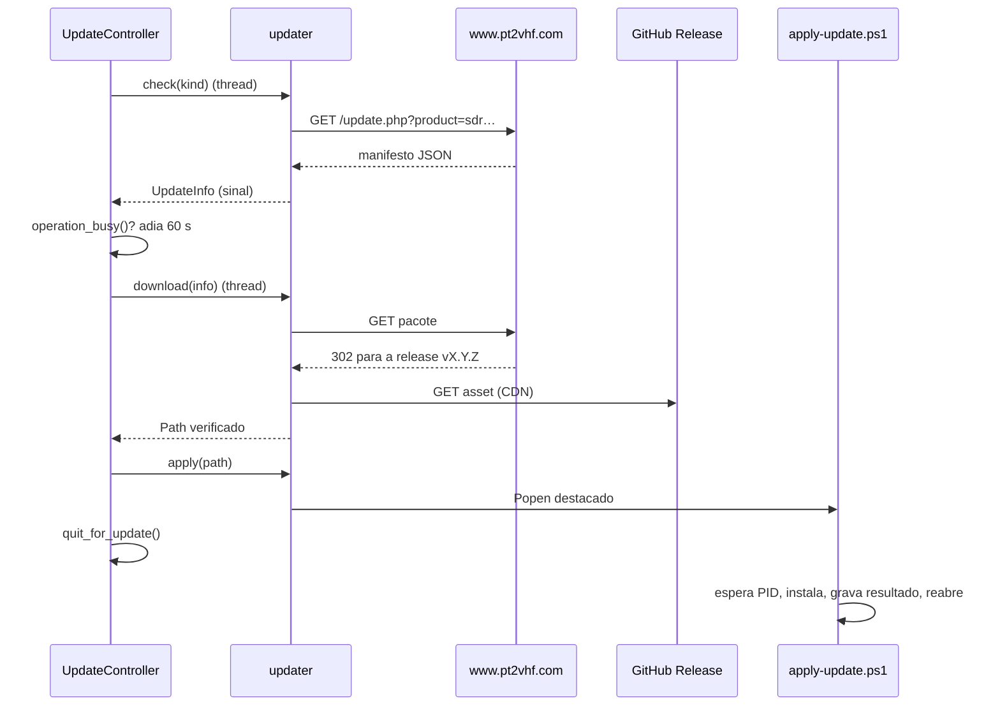

# Atualização OTA, Design Técnico

## Interface

| Símbolo | Assinatura | Retorno | Observação |
|---------|-----------|---------|------------|
| `install_kind` | `(exe_path=None, frozen=None)` | `"installer"\|"portable"\|"source"` | |
| `is_official` | `(url, name)` | `bool` | Contrato de URL oficial |
| `select_update` | `(manifest, kind, current, allow_test_host=False)` | `UpdateInfo \| None` | `UpdateError` em manifesto inválido |
| `check` | `(kind=None, base_url=UPDATE_URL, timeout=20)` | `UpdateInfo \| None` | |
| `download` | `(info, progress=None, dest_dir=None, timeout=60)` | `Path` | Verificado |
| `apply` | `(path, kind, version)` | `None` | Só Windows congelado |
| `read_update_result` | `(temp_dir=None)` | `(status, versão, detalhe) \| None` | Apaga após ler |
| `UpdateController` | `(window, button)` | — | `check`, `try_auto`, `maybe_prompt`, `start`, `show_last_result` |

Contratos HTTP e do auxiliar em [contracts.md](contracts.md).

## Fluxo Principal

## Fluxos Alternativos
- **Erro de rede ou manifesto:** mensagem só em verificação manual. 🟢
- **Pacote inválido:** "OTA indisponível" com motivo. 🟢
- **Falha de download:** `update_failed` por 6 h; botão "Falha ao atualizar · tentar novamente". 🟢
- **`apply` falha:** diálogo "Atualização não aplicada"; o programa continua aberto. 🟢
- **Auxiliar falha:** resultado de erro mostrado na próxima abertura e arquivo `…-update-error.txt` em %TEMP%. 🟢

## Dependências
- Site oficial (`update.php`, `/downloads/sdr-tool/`, `/download.php`) e GitHub Releases. 🟢 `integrations.md`
- PowerShell do Windows e Inno Setup (instalador). 🟢

## Decisões de design
- Auxiliar externo em vez de autossubstituição: o EXE em uso não pode ser sobrescrito. 🟢 ADR (Detetive)
- Sem fallback de navegador para não mascarar falha de OTA. 🟢 `ui/assist_panels.py:267-269`

## Lacunas
- 🔴 Homologação ponta a ponta no Windows real.
- 🟡 Sem assinatura de código (Authenticode) conferida pelo cliente.
- 🟡 `check_updates` morto; `auto_update` fora de DEFAULTS.
