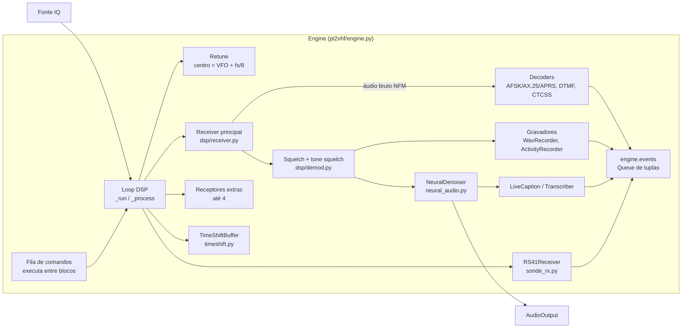
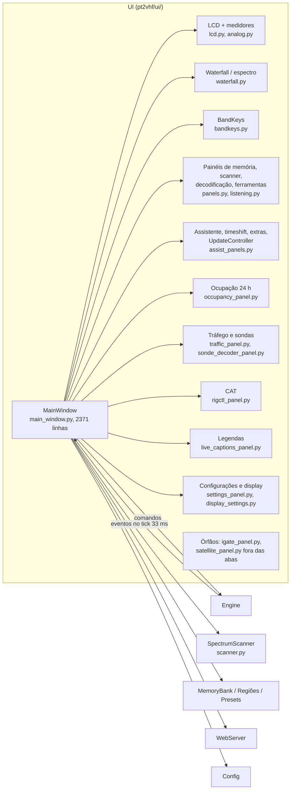

# C4 — Nível 3: Componentes

Componentes dos dois containers centrais: **Engine DSP** e **UI Qt**. Os módulos de domínio estão em `pt2vhf/`.

## Engine DSP

## UI Qt

| Componente | Responsabilidade | Observação |
|---|---|---|
| `MainWindow` | Orquestra tudo: sintonia, níveis, OTA, web, scanner, eventos | 🟡 God object; concentra ~11% do código |
| `SpectrumScanner` | Varredura FFT com estados | Chama `engine.tune` diretamente 🟢 |
| `UpdateController` | Fluxo OTA na UI | Adia quando `operation_busy()` 🟢 |
| `RS41Receiver` | Pipes para binários externos | 🔴 RF real |
| `aprs_igate.ReceiveOnlyIGate`, `igate_panel` | Sem uso | 🟢 órfão desde v0.10.0 |
| `SatellitePanel` | Biblioteca orbital preservada | 🟢 fora das abas |
