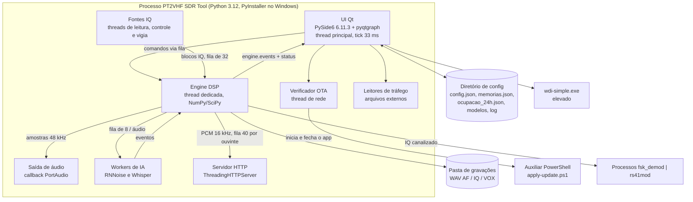

# C4 — Nível 2: Containers

Um único processo Python com várias threads, mais processos auxiliares. Não há banco de dados; a persistência é JSON, WAV e log no diretório de configuração.

| Container | Tecnologia | Responsabilidade | Confiança |
|---|---|---|---|
| UI Qt | PySide6, pyqtgraph | Janela, LCD, waterfall, painéis; dona exclusiva dos widgets | 🟢 |
| Engine DSP | NumPy/SciPy, thread | Demodulação, squelch, decoders, gravação, timeshift, extras | 🟢 |
| Fontes IQ | pyrtlsdr, socket, SoapySDR, WAV, simulador | Aquisição e recuperação do dongle | 🟢 |
| Saída de áudio | sounddevice | Buffer com prime de 150 ms | 🟢 |
| Workers de IA | pyrnnoise, faster-whisper | Redução de ruído, legendas e transcrição fora da thread RF | 🟢 |
| Servidor HTTP | `http.server` | Painel web somente leitura | 🟢 |
| Verificador OTA | `urllib` | Manifesto, download e verificação SHA-256 | 🟢 |
| Auxiliar PowerShell | `apply-update.ps1` | Substitui o executável após o app fechar | 🟢 código, 🔴 campo |
| fsk_demod + rs41mod | Binários externos | Demodulação e decodificação RS41 | 🔴 RF real |
| wdi-simple | libwdi | Instala WinUSB com um UAC | 🟢 (sem testes) |
