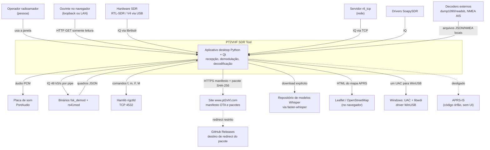

# C4 — Nível 1: Contexto

O PT2VHF SDR Tool é um **receptor SDR desktop** de um único operador. Ele não transmite RF e não envia áudio para fora da máquina, salvo pelo painel web local ou da LAN.
Escala: 🟢 confirmado · 🟡 inferido · 🔴 lacuna.

| Elemento | Relação | Protocolo | Confiança |
|---|---|---|---|
| Operador | Opera tudo pela UI Qt | Local | 🟢 |
| Ouvinte web | Lê estado, espectro e áudio | HTTP GET, porta 8095 | 🟢 |
| RTL-SDR | Fonte IQ principal | USB, librtlsdr (Blog ou padrão) | 🟢 |
| rtl_tcp | Fonte IQ remota | TCP | 🟢 |
| SoapySDR | Fonte IQ genérica | Biblioteca nativa | 🟢 (sem testes) |
| PortAudio | Saída de áudio | sounddevice | 🟢 |
| dump1090/readsb, AIS | Tráfego por arquivo | JSON, NMEA | 🟢 |
| fsk_demod/rs41mod | Decodificação RS41 | stdin/stdout | 🟢 código, 🔴 RF real |
| rigctld | CAT sem PTT | TCP texto Hamlib | 🟢 |
| www.pt2vhf.com | OTA | HTTPS, SHA-256 | 🟢 código, 🔴 campo |
| GitHub Releases | Hospedagem do pacote | HTTPS redirect restrito | 🟢 |
| Modelos Whisper | Download sob demanda | HTTPS via `faster_whisper.utils.download_model` | 🟡 origem (Hugging Face) inferida da biblioteca |
| Leaflet/OSM | Mapa no navegador | HTTPS (unpkg, tile.openstreetmap.org) | 🟢 |
| Windows UAC/libwdi | Driver WinUSB | ShellExecute `runas` | 🟢 |
| APRS-IS | Sem uso na UI | TCP 14580 | 🟢 órfão |
