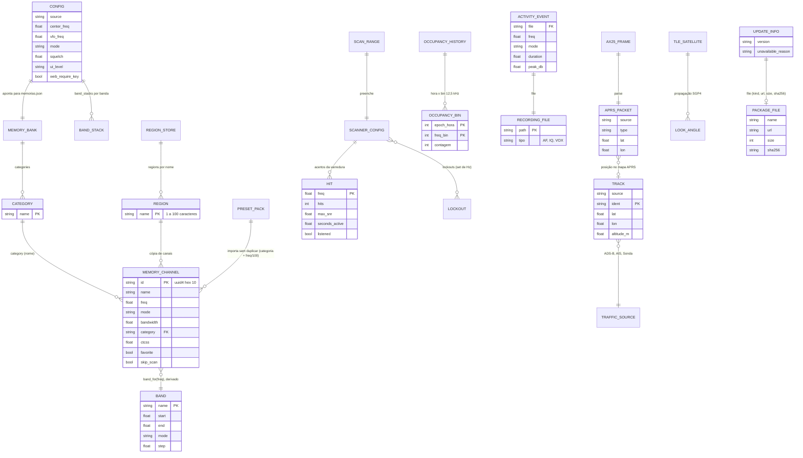

# ERD completo

Não há banco de dados 🟢. As "entidades" são dataclasses em memória, persistidas como JSON, WAV ou log. O ERD abaixo mostra as relações lógicas e onde cada uma é gravada. Detalhes de campos em [data-dictionary.md](data-dictionary.md).

## Persistência

| Entidade | Arquivo | Atômica? | Confiança |
|---|---|---|---|
| CONFIG | `config.json` | ❌ | 🟢 |
| MEMORY_BANK, CATEGORY, MEMORY_CHANNEL | `memorias.json` | ❌; JSON corrompido não é tratado no load | 🟢 |
| REGION_STORE | arquivo de regiões | ✅ | 🟢 |
| OCCUPANCY_HISTORY | `ocupacao_24h.json` | ✅, no máximo 1 vez a cada 20 s | 🟢 |
| HIT, LOCKOUT | Só em memória | — | 🟢 |
| ACTIVITY_EVENT / RECORDING_FILE | WAV na pasta de gravações | Escrita contínua | 🟢 |
| TRACK | Lido de arquivos externos | — | 🟢 |
| UPDATE_INFO | Memória; resultado do auxiliar em `%TEMP%` | — | 🟢 |
