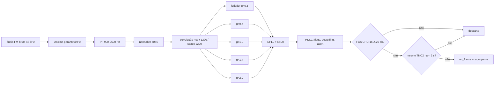
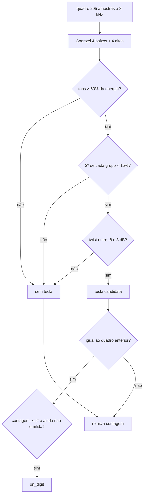

# Fluxogramas — `decoders`

> Arqueólogo (Reversa), 2026-11-27. 🟢 extraído de `pt2vhf/decoders/`.

## APRS: áudio até pacote



## `aprs.parse` por tipo de dado

```mermaid
flowchart TD
    A[info] --> B{1º caractere}
    B -- "! = / @" --> P[Posição, pula timestamp em / @]
    P --> P1{dígito?}
    P1 -- sim --> P2[não comprimida]
    P1 -- não --> P3[comprimida base 91]
    P2 & P3 --> P4[ccc/sss e /A=]
    P4 --> P5{símbolo termina em _?}
    P5 -- sim --> WX[Clima, ccc/sss vira vento]
    P5 -- não --> POS[Posição]
    B -- "` ' 0x1c 0x1d" --> MIC[Mic-E]
    B -- ">" --> ST[Status]
    B -- ":" --> MSG{PARM/UNIT/EQNS/BITS?}
    MSG -- sim --> TD[Telemetria def.]
    MSG -- não --> M[Mensagem sem id]
    B -- "T#" --> TL[Telemetria]
    B -- "_" --> WX2[Clima posicional]
    B -- "," --> OBJ[Objeto]
    B -- "}" --> TP[Terceiros]
    B -- outro --> OUT[Outro]
```

## DTMF por quadro


