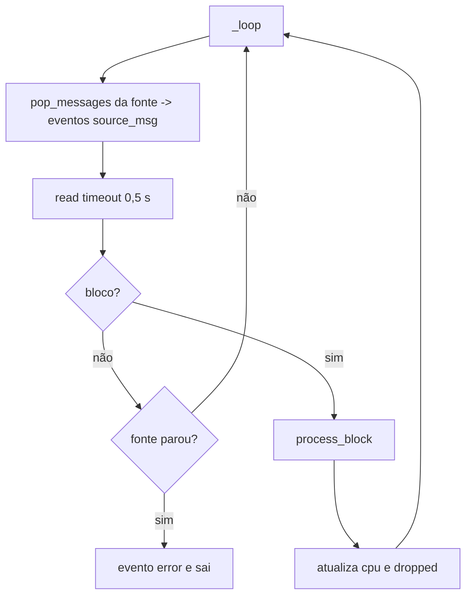
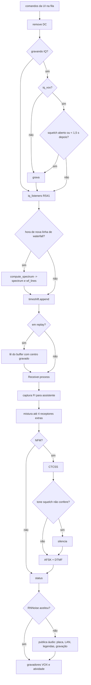
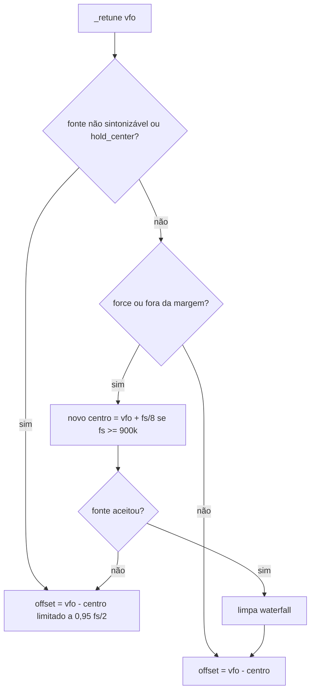
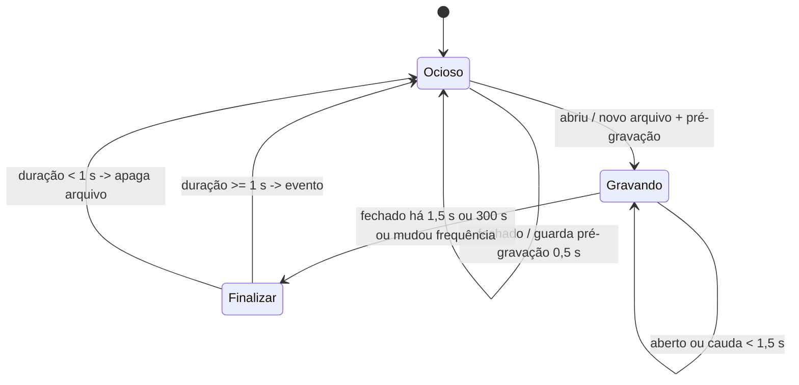

# Fluxogramas — `engine`

> Arqueólogo (Reversa), 2026-11-27. 🟢 extraído de `pt2vhf/engine.py`, `audio.py`, `timeshift.py`.

## Loop da thread DSP

## `process_block`

## `_retune`

## `ActivityRecorder.process`

