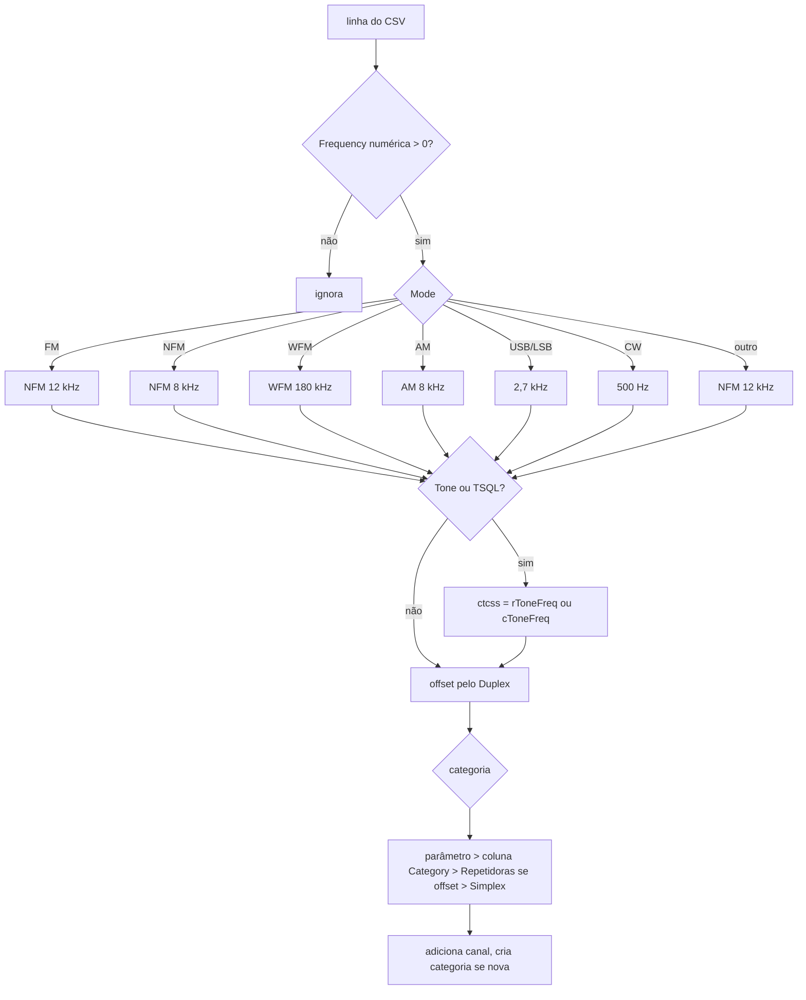
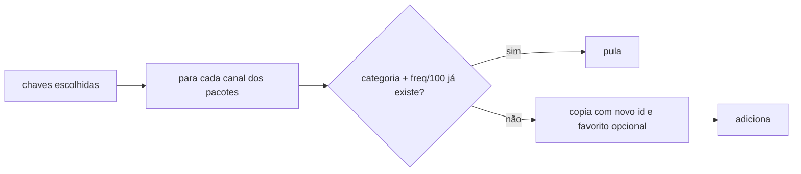
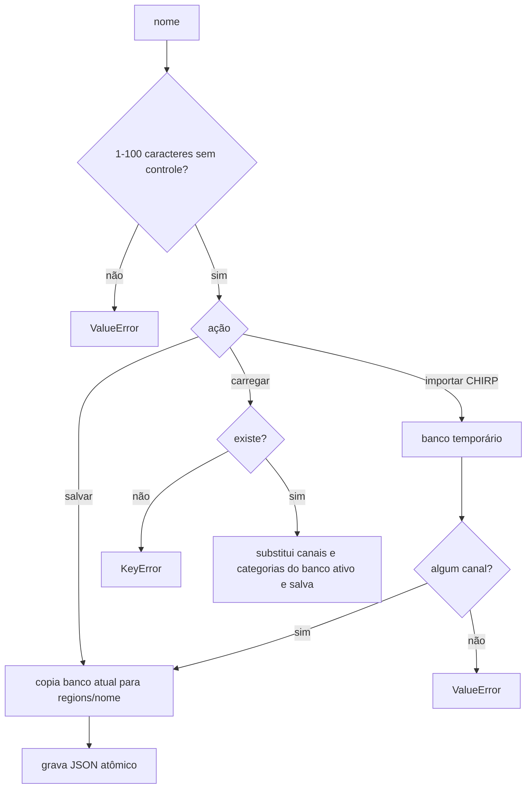

# Fluxogramas — `memory`

> Arqueólogo (Reversa), 2026-11-27. 🟢 extraído de `pt2vhf/memory.py`, `memory_regions.py`, `presets.py`.

## Importação CSV CHIRP

## Importação de pacotes prontos

## Perfil por região

