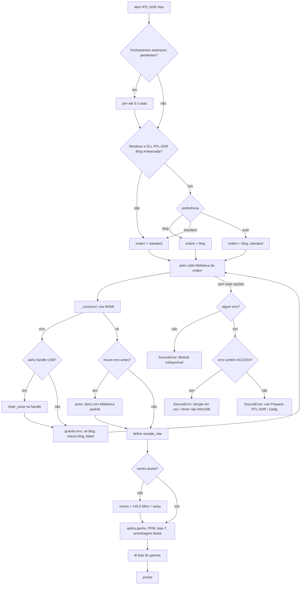
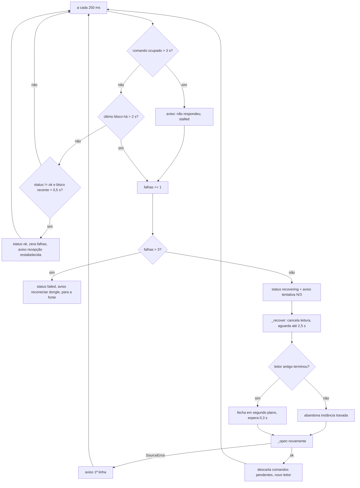
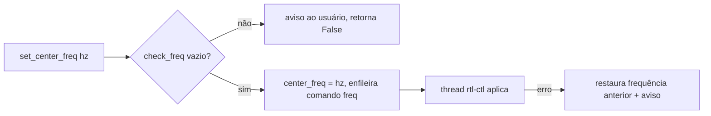
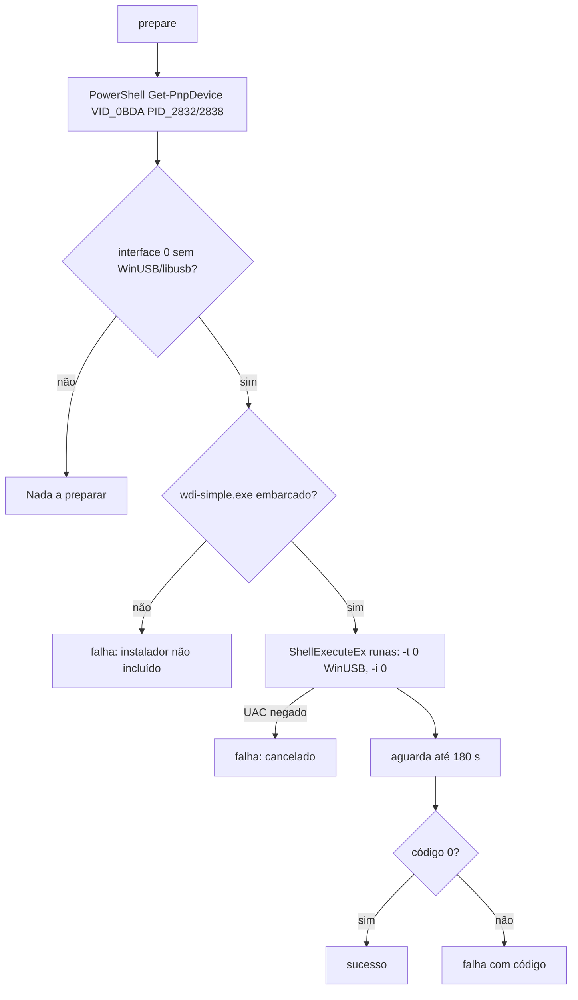

# Fluxogramas — `sources`

> Arqueólogo (Reversa), 2026-11-27. 🟢 extraído de `pt2vhf/sources/`.

## Abertura do RTL-SDR (`RtlSdrSource._default_factory` + `_open`)

## Vigia e recuperação (`_watch_loop`)

## Mudança de frequência

## Preparação de driver no Windows (`rtl_driver.prepare`)

