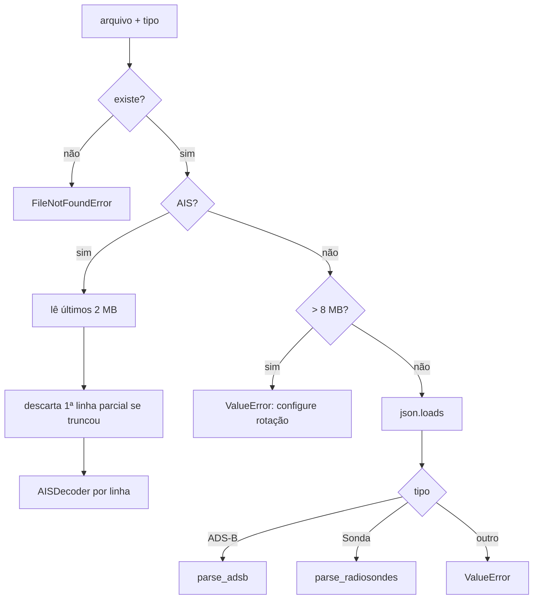
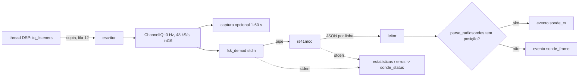
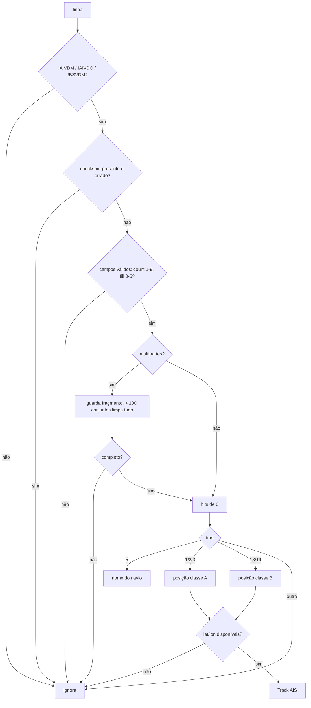

# Fluxogramas — `traffic`

> Arqueólogo (Reversa), 2026-11-27. 🟢 extraído de `pt2vhf/traffic.py`, `sonde_rx.py`, `aprs_igate.py`.

## Leitura de feeds externos (`load_traffic`)



## Pipeline RS41



## AIS: montagem e decodificação



## iGate RX-only (`gate_line`)

```mermaid
flowchart TD
    A[TNC2 recebido] --> B{CR/LF/NUL?}
    B -- sim --> X[descarta]
    B -- não --> C{tem ':' e payload não começa com '}'?}
    C -- não --> X
    C -- sim --> D{origem é indicativo válido?}
    D -- não --> X
    D -- sim --> E{caminho com TCPIP/TCPXX/NOGATE/RFONLY/IGATE/GATE/qA*?}
    E -- sim --> X
    E -- não --> F[acrescenta qAO,indicativo]
    F --> G{latin-1 e <= 512 bytes?}
    G -- não --> X
    G -- sim --> H{duplicado em 45 s?}
    H -- sim --> X
    H -- não --> Q[fila 256 -> socket após logresp verified]
```
