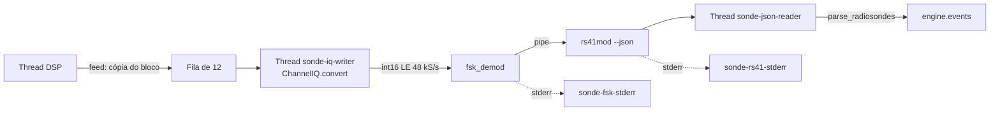

# Radiossonda RS41, Design Técnico

## Interface

| Símbolo | Assinatura | Retorno | Observação |
|---------|-----------|---------|------------|
| `find_binary` | `(executable, supplied_path="")` | `str` | `FileNotFoundError` com orientação |
| `build_decoder_commands` | `(freq_hz, fsk_binary, rs41_binary)` | `(argv_fsk, argv_rs)` | Faixa 400–406 MHz |
| `ChannelIQ` | `(sample_rate, station_hz)` | — | `convert(block, center_hz) -> bytes` |
| `RS41Receiver` | `(sample_rate, station_hz, on_decoded, on_status=None, fsk_path="", decoder_path="", on_frame=None)` | — | |
| `RS41Receiver.start` / `stop` | `()` | — | |
| `RS41Receiver.feed` | `(iq, center_hz, sample_rate)` | — | Chamado pela thread DSP via `iq_listeners` |
| `RS41Receiver.diagnostics` | `()` | `dict` | `iq_blocks, iq_samples, iq_bytes, dropped, json_frames, positions, unpositioned_frames, invalid_json, frame, demod, error, capture, fsk_alive, decoder_alive, frequency, sample_rate` |
| `RS41Receiver.start_capture` | `(path, duration=20)` | — | 1–60 s |
| Eventos | `sonde_rx (Track, json)`, `sonde_frame json`, `sonde_status str` | — | |

## Fluxo Principal

1. `_start_sonde` valida, sintoniza, cria o receptor e o registra em `engine.iq_listeners`. 🟢
2. A engine chama `feed(blk, centro, fs)` por bloco. 🟢 `engine.py:345-348`
3. O escritor converte e escreve no stdin do `fsk_demod` (e na captura, se ativa). 🟢
4. O leitor interpreta o JSON e chama `on_decoded` ou `on_frame`. 🟢

## Fluxos Alternativos
- **Centro mudou:** `ChannelIQ` reinicia fase, histórico e estado do filtro. 🟢 `sonde_rx.py:83-88`
- **Sonda perto da borda:** `ValueError` "Frequência da sonda fora da banda IQ capturada". 🟢
- **Falha ao iniciar processos:** `stop()` e mensagem "Não foi possível iniciar RS41". 🟢

## Dependências
- Binários `fsk_demod` e `rs41mod` do operador. 🟢
- SciPy (`butter`, `sosfilt`, `resample_poly`). 🟢
- `parse_radiosondes` (tráfego). 🟢

## Decisões de Design Identificadas

| Decisão | Evidência no código | Confiança |
|---------|---------------------|-----------|
| Mesmo SDR, sem segundo dongle (ADR 010) | `sonde_rx.py:1`, `ui/main_window.py:1469` | 🟢 |
| Banda base 0 Hz (fa10118) | `sonde_rx.py:26` | 🟢 |
| Diagnóstico separa IQ recebido de quadro válido | `sonde_rx.py:274-289` | 🟢 |

## Estado Interno
Contadores de diagnóstico, `_queue`, `_stop`, processos, threads, estado de captura. Máquina em `state-machines.md` §8. 🟢

## Observabilidade
`diagnostics()` exibido em `SondeDecoderPanel.update_diagnostics`; status textual com quadros recebidos. 🟢

## Riscos e Lacunas
Ver `questions.md`.
