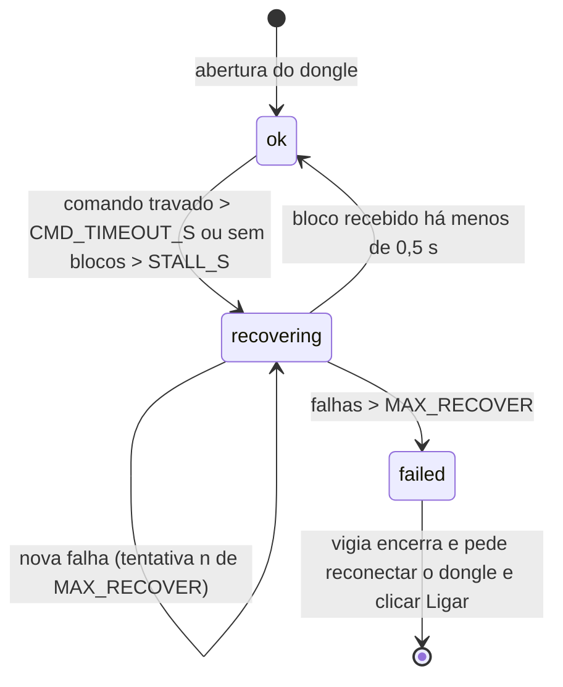
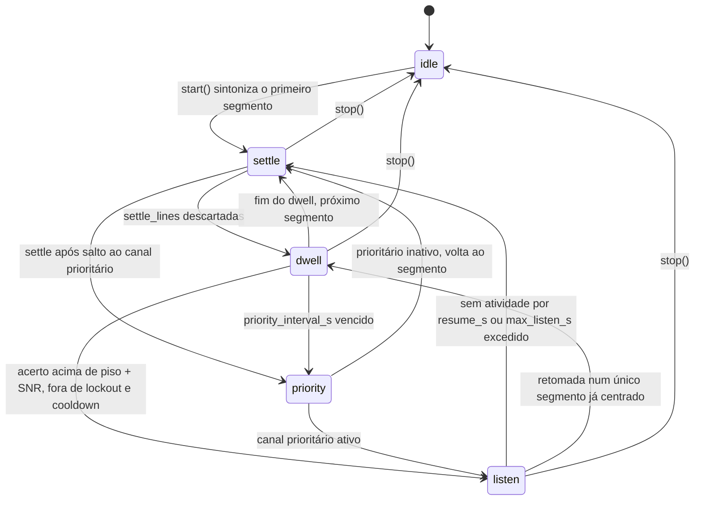
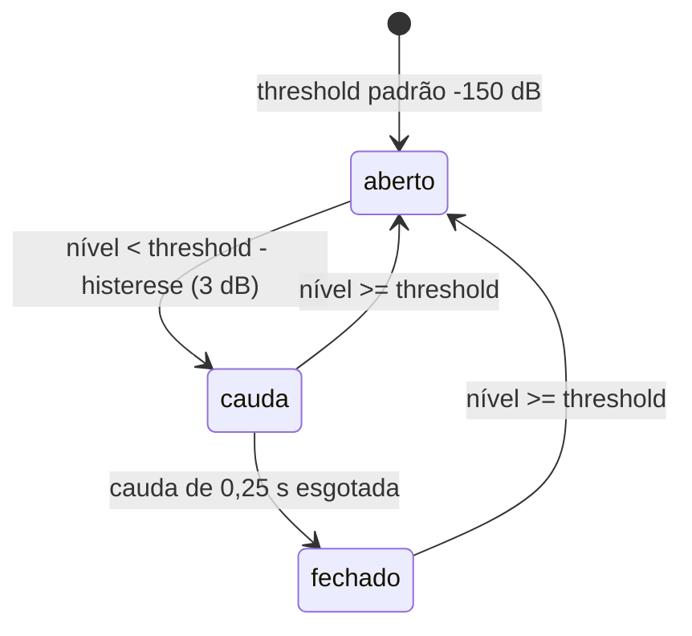
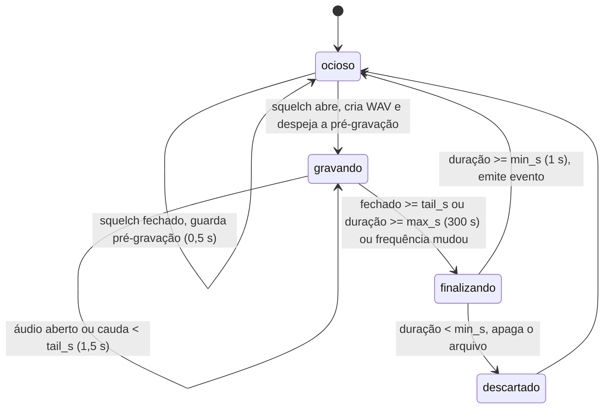
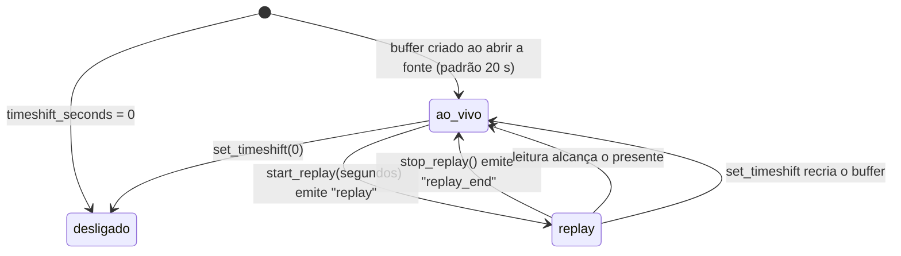
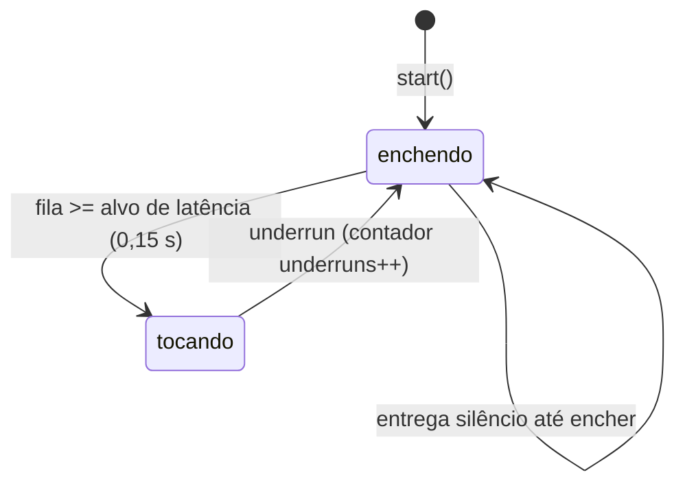
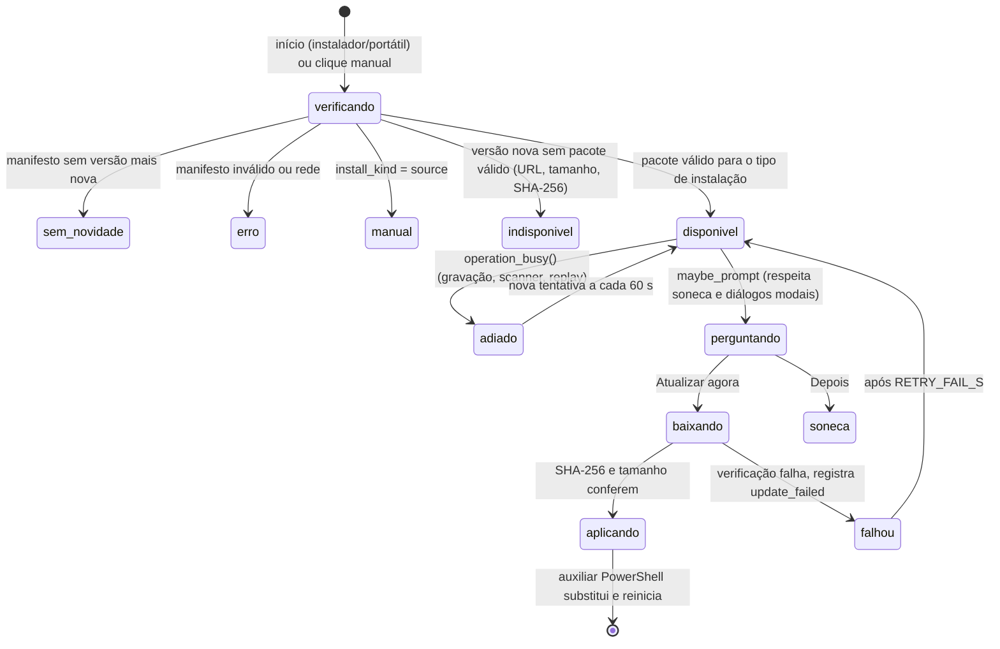
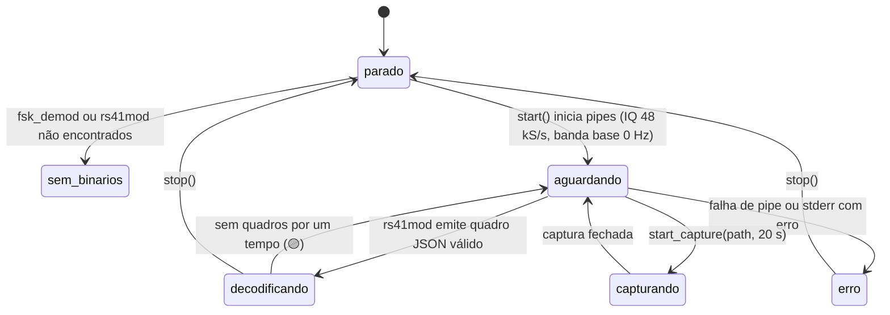
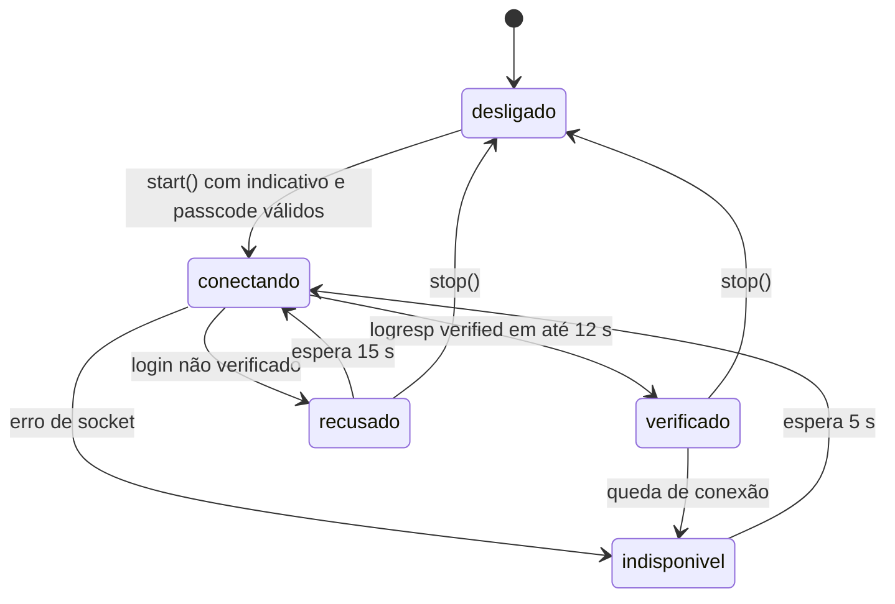

# Máquinas de estado — PT2VHF SDR Tool

Extraídas pelo Detetive a partir do código da branch `claude/project-thread-hzahgn` (base PR #32, v0.13.3).
Escala: 🟢 confirmado no código · 🟡 inferido · 🔴 lacuna.

## 1. Fonte RTL-SDR: saúde da recepção 🟢
`pt2vhf/sources/rtlsdr_source.py:183,478-503` (`status`: ok | recovering | failed)

Regras:
- O vigia roda a cada 0,25 s. A recuperação cancela a leitura antiga em thread separada e reabre o dispositivo.
- Ao voltar a `ok`, o contador de falhas zera e a mensagem "Recepção restabelecida." é emitida.
- 🟡 rtl_tcp e SoapySDR não têm essa máquina; erros sobem como `SourceError`.

## 2. Scanner espectral 🟢
`pt2vhf/scanner.py:145-360` (`state`: idle | settle | dwell | priority | listen)

Regras:
- Em `listen`, o limiar de atividade é `piso + 0,7 × snr_db` (histerese implícita).
- Ao sair de `listen`, a frequência entra em `_cooldown`, evitando parar de novo no mesmo canal logo em seguida.
- Lockout usa tolerância por frequência arredondada.

## 3. Squelch 🟢
`pt2vhf/dsp/demod.py:146-167`

## 4. Gravação por atividade (ActivityRecorder) 🟢
`pt2vhf/audio.py:144-240`

Variante `single_file` (VOX de sessão): todas as transmissões vão para um único arquivo `_VOX`; trechos curtos não geram evento, mas o arquivo não é apagado.

## 5. Timeshift (voltar no tempo) 🟢
`pt2vhf/engine.py:236-269,360-367`

## 6. Saída de áudio (priming) 🟢
`pt2vhf/audio.py:36-105`

## 7. Atualização OTA (UpdateController) 🟢
`pt2vhf/ui/assist_panels.py:196-330`, `pt2vhf/updater.py`

🔴 O fluxo ponta a ponta no Windows real não está homologado (P0 do BACKLOG).

## 8. Receptor RS41 🟢/🔴
`pt2vhf/sonde_rx.py:113-330`

🔴 Nunca demonstrado com RF real (serial, posição e altitude no mapa).

## 9. iGate APRS-IS (código órfão) 🟡
`pt2vhf/aprs_igate.py:71-170`. A UI foi removida na v0.10.0; a máquina existe só no código.

## Lacunas
- 🔴 Comportamento do watchdog com rtl_tcp/SoapySDR sob falha real.
- 🟡 Estado do decodificador APRS/AFSK não é uma máquina explícita (fluxo contínuo de bits).
- 🟡 Estados de gravação manual de áudio/IQ são booleanos (`recording_audio`, `recording_iq`) sem máquina formal.
